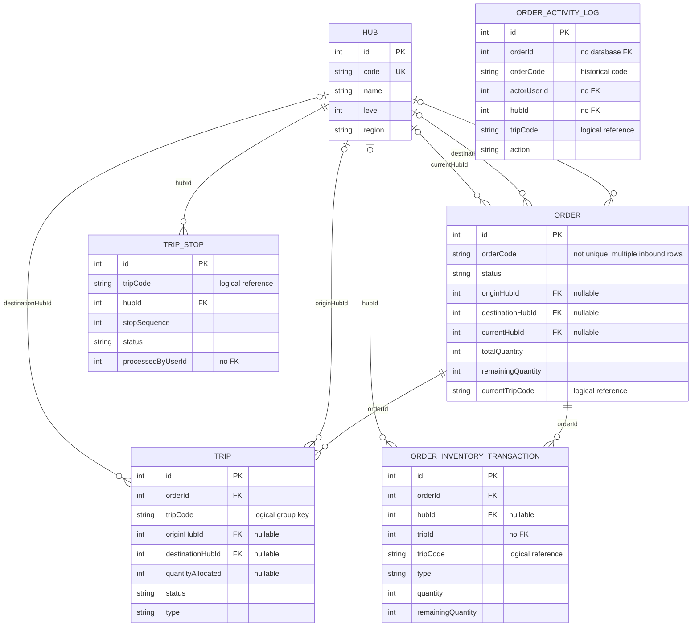
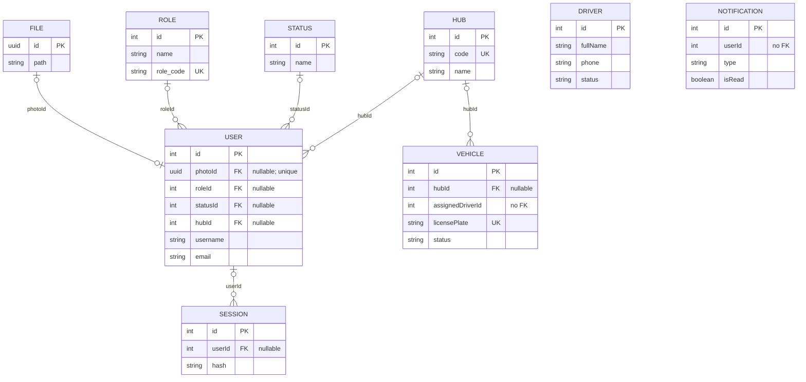
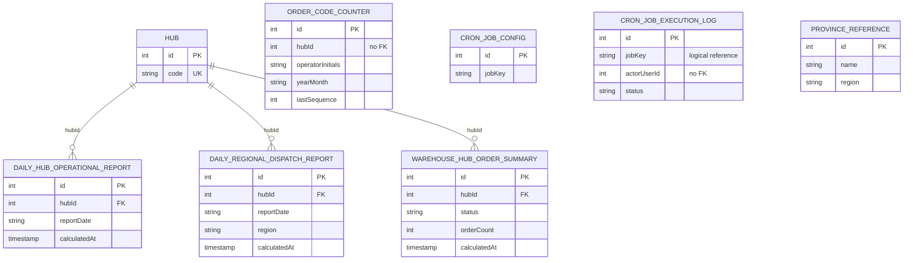

# Current database relationship diagram

**Source:** read-only PostgreSQL catalog query against `logistics_tms_core` on 2026-11-24 at 12:27 UTC, cross-checked with backend TypeORM entities and migrations. The database contains 21 application tables plus TypeORM's `migrations` table, and 18 foreign key constraints. Its latest recorded migration is `RepairSerialSequences1789180000000`.

The 21 application tables are split into three diagrams for readability. `FK` marks a foreign key confirmed in the database catalog. Nullable foreign keys are marked `FK nullable`. Columns without an `FK` mark are **not** database-enforced relationships, even when their names look like IDs.

## Orders, trips, and warehouse ledger

`trip` is one allocation row per order on a logical trip. Rows with the same `tripCode` form a trip; `trip_stop.tripCode`, `order.currentTripCode`, and ledger `tripCode` refer to that group without a foreign key. `order.orderCode` is deliberately non-unique so separate inbound records can share one waybill. The warehouse ledger is `order_inventory_transaction`; its `tripId` has no foreign key. `order_activity_log.orderId` has a TypeORM relation, but the database contains only an index, not a foreign key constraint.

## Accounts and fleet

`vehicle.assignedDriverId` and `notification.userId` are stored identifiers without declared foreign keys. `trip` stores `licensePlate` and `driverName` as text; the old direct vehicle and driver relations were removed by migrations.

## Reports and independent reference tables

The three report tables are persisted snapshots keyed by hub and reporting date/status, not live joins to `order` or `trip`. `order_code_counter.hubId`, cron `jobKey`, and `order.province` are logical references without foreign keys to `hub`, `cron_job_config`, or `province_reference`, respectively.

## Verification

- Relationship lines match all 18 foreign key rows returned by `information_schema.table_constraints`, `key_column_usage`, and `constraint_column_usage` in the current database.
- The table list matches the live catalog: 21 application tables and `migrations` (bookkeeping, omitted from the diagrams). Apparent IDs without a catalog constraint are labeled `no FK`, including the divergent `order_activity_log.orderId` mapping.
